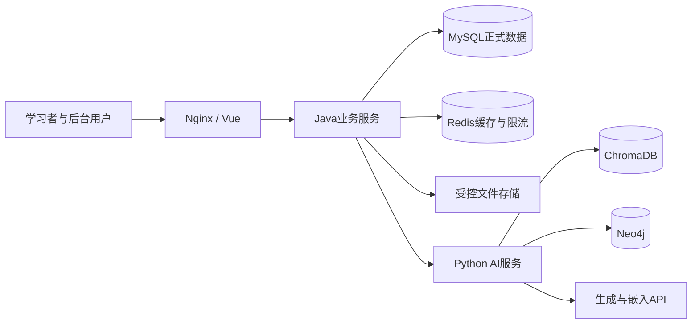

# 中医科普学习平台：项目架构设计

基线：2026-10-22。本设计继承已确认的六模块功能清单。当前阶段交付工程目录蓝图、数据库迁移与业务约束；尚未实现业务API和页面。

## 1. 方案与技术栈

采用单仓库、Vue前端、Java模块化单体、Python AI服务。Java内部按业务领域分包，通过应用服务协作，不拆成六个网络微服务。Python专注解析、检索、生成和索引，不直接维护业务MySQL。

| 部分 | 选择 | 边界 |
|---|---|---|
| 前端 | Vue3、Vite、TypeScript、Element Plus、Pinia、Axios | 一个应用，学习门户与后台使用不同布局 |
| 业务服务 | 本机JDK17、Spring Boot3.5系列、Spring Security、MyBatis-Plus、Flyway | 唯一正式业务数据写入入口 |
| AI服务 | Python3.11环境、FastAPI、Pydantic、OpenAI兼容SDK | 本机现有Python3.9仅用于本次无第三方依赖的生成与验证脚本 |
| 对话 | DeepSeek兼容接口，模型名通过环境变量配置 | 不在代码中写死密钥或假定价格 |
| 嵌入 | 保留原开题text-embedding-v3配置项 | 更换模型或维度必须新建索引代次并重建，禁止混用向量 |
| 存储 | MySQL8.0.16+、Redis7、ChromaDB、Neo4j5系列 | MySQL为正式依据；Redis及检索索引可以重建 |
| 部署 | Docker Compose、Nginx、本地持久化文件卷 | 首轮不增加网关注册中心、消息队列或对象存储集群 |

后续创建可运行骨架时再按可获取版本锁定依赖、生成锁文件并验证构建；本阶段不提供未经构建验证的pom或package版本组合。

官方依据：
- Spring Boot3.5支持Java17：https://docs.spring.io/spring-boot/3.5/system-requirements.html
- MySQL CHECK：https://dev.mysql.com/doc/refman/8.0/en/create-table-check-constraints.html
- MySQL外键：https://dev.mysql.com/doc/refman/8.0/en/create-table-foreign-keys.html

## 2. 服务拓扑



浏览器只访问Java公共API。Python和数据库仅位于内网。Java鉴权后传递任务ID、traceId、精简上下文和经授权的证据；Python调用内部只读接口取得正式知识和结构化事实。禁止客户端直接指定任意文件系统路径、Cypher或SQL。

## 3. 工程目录与模块边界

```text
tcm-learning-platform/
  frontend/src/
    app/                   应用入口与布局
    router/                路由与页面权限提示
    shared/{api,components,types,stores}/
    modules/{knowledge-base,knowledge,qa,learning,recommendation,community,account,admin}/
  backend/src/main/java/cn/tcm/platform/
    common/                错误响应、时间、分页、追踪
    identity/              账户、JWT、角色资格
    content/               资源、版本、标签、来源、审核
    knowledge/             药材、方剂、别名、关系和识别
    qa/                    私有会话、证据、SSE、评价
    learning/              专题、题目、作答、进度、错题
    recommendation/        事件、画像、策略、曝光归因
    community/             投稿、讨论、评论、举报
    operations/            文件、通知、后台任务、审计与备份
  backend/src/main/resources/db/migration/
  ai-service/app/{api,core,ingestion,retrieval,generation,indexing,evaluation}/
  contracts/               API及内部服务约定
  database/                关系模型及图谱投影定义
  docs/                    架构、字典、关系图、规则、需求映射
  deploy/                  部署拓扑与持久化约定
  scripts/                 数据库验证工具
```

每个Java业务领域内部采用api/application/domain/infrastructure四层：Controller处理请求校验；Application Service编排权限、事务和外部服务；Domain承载状态规则；Infrastructure使用Mapper和外部适配器。避免一个公共Service直接读写全部模块的表。

跨模块调用使用明确的应用服务接口。共享版本、审核、收藏和通知均复用，不在六模块各建一套。数据库迁移由Java统一管理，Python不运行Flyway或另建同名业务表。

## 4. 数据与文件的归属

- MySQL：内容身份、版本、证据、结构化事实、试卷快照、推荐记录和业务状态。
- 原始文件：本地挂载卷，数据库保存哈希及相对存储键；原文件不塞入MySQL大字段。
- ChromaDB：原文片段和正式知识的检索投影，ID包含revisionId/segmentId/indexGeneration；元数据保留证据定位。
- Neo4j：已审核知识与方剂组成的关系投影，不承担唯一事实保存职责。
- Redis：短期缓存、限流计数、可重建画像缓存；不作为唯一学习记录或试卷保存位置。

本机可使用Java8080、AI8000、前端5173。MySQL端口从配置读取，不能假定Windows3306与Docker映射端口属于同一实例。

## 5. 异步任务与一致性

发布事务同时更新正式版本指针并插入async_jobs，提交后worker调用Python建立索引。任务以对象版本和索引配置构造幂等键。使用FOR UPDATE SKIP LOCKED领取任务，写入租约和run_token；完成回写必须匹配当前run_token。失败进入RETRY_WAIT，次数耗尽进入DEAD，由管理员查看及重试。

MySQL提交与Chroma/Neo4j写入不构成一个原子事务。索引是最终一致的；检索结果在生成前由Java重新检查可见性、版本资格和来源可用性。晚到的旧任务不能替换新版本；新索引就绪前不会把未索引状态标成可检索。

## 6. 鉴权与接口约定

JWT短期访问令牌放前端内存；刷新令牌使用HttpOnly Cookie并在MySQL保存哈希，轮换时撤销旧令牌。跨站请求和刷新端点校验Origin/CSRF，生产Cookie设Secure。禁用和密码重置递增credential_version并撤销刷新链。

新用户默认LEARNER；贡献资格由ADMIN审批；审核者单独授权。ADMIN不自动拥有专业审核权限。游客无需角色表记录。所有私有记录都按当前登录用户过滤，不能仅依赖前端路由或不可猜ID。

普通响应包含code/message/data/traceId；分页使用page/pageSize/total/items，pageSize上限100。全部BIGINT ID以字符串返回；时间使用UTC ISO8601，前端按Asia/Shanghai显示。

SSE使用fetch流以便携带Authorization；事件为meta、delta、citation、done、error，每条有eventId。停止和断线均有明确终态；首次实现不自动续播未完成模型请求，用户重试使用新attemptKey并保留原消息状态。

## 7. 运行与验证边界

健康接口区分liveness和readiness。业务就绪需要MySQL及迁移成功；未配置模型密钥时明确标记AI不可用，仍允许知识浏览及学习等独立功能。Python出站访问需要超时，日志不输出密钥和用户完整敏感输入。

本次仅验证数据库迁移与部分数据约束，不代表Spring、Vue、FastAPI、模型接口或Docker整栈已运行。
