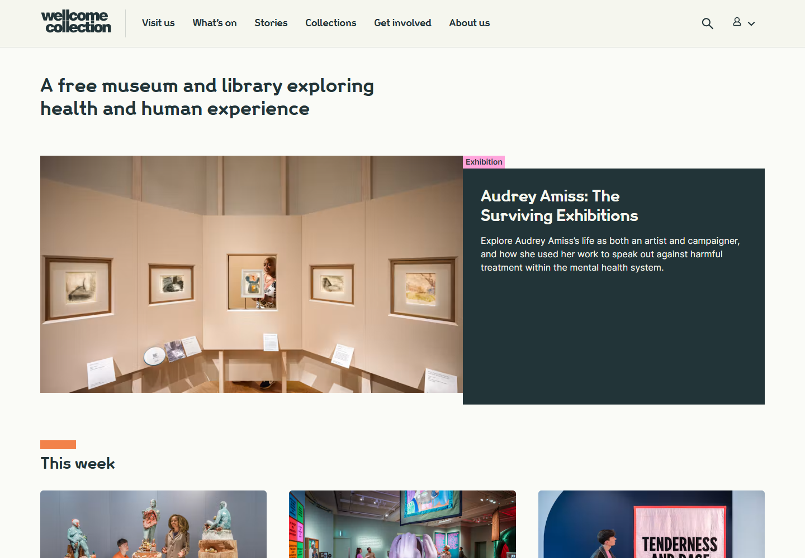
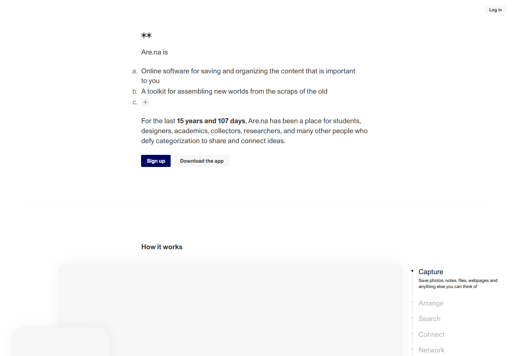

# 全站 UI/UX 参考调研与设计决策

调研日期：2026-11-24。先调研、后修改前端；此次是既有 Vue 3 + TypeScript + Element Plus 产品的视觉重构，不改变接口、认证、路由或业务状态。

## 证据与访问边界

网页提取用于验证内容组织，Edge/Playwright 用于真实页面截图（复用项目依赖，1440×1000 与 390×844）。HTTP 200 不等于全部资源加载成功；首屏、滚动位置和手机截图分别记录。截图仅作为设计研究证据，不复制为产品素材。浏览器访问记录见忽略目录 `runtime/design-reference-access.json`、`runtime/design-reference-detail.json`。

| 优先参考平台 | 本次结果 | 使用方式 |
|---|---|---|
| [Awwwards](https://www.awwwards.com/) | 网页提取可读；访问 [Kanak Naturals 案例](https://www.awwwards.com/sites/kanak-naturals)及真实站 | 寻找自然主题的图文节奏；不将获奖等同本项目适用 |
| [Siteinspire](https://www.siteinspire.com/) | 首页与 [Health & Fitness](https://www.siteinspire.com/websites/category/health-and-fitness) 可读 | 分类组织、编辑精选入口；未宣称浏览全部案例 |
| [Mobbin](https://mobbin.com/) | 公开首页可读，存在登录入口 | 仅参考公开的模式检索和产品分类，不声称访问其付费流程库 |
| [Behance](https://www.behance.net/) | 首页及具体案例均 403 | 搜索取得 [Spices & herbs](https://www.behance.net/gallery/188569771/Spices-herbs-Website-UI-Design) 与 [Herbal Medicine](https://www.behance.net/gallery/66297663/Herbal-Medicine-UI-Design?locale=en_US)；仅作为线索，不据此分析交互 |
| [Dribbble](https://dribbble.com/) | 公开页可读 | 搜索、标签与视觉探索入口；作品图片不是完整产品流程，不推断其响应式和业务可用性 |
| [Land-book](https://land-book.com/) | 网页提取 403 | 记录失败，转向真实站点；未伪造案例或截图 |

内置浏览器创建 Kew 标签超时；原生 Edge 窗口最小化导致控制失败。随后按任务要求复用现有 Playwright 和 Edge 获取截图。Kew、FutureLearn、Stack Overflow 在直接浏览器中返回 403 验证页；其截图只是访问失败证据，不是页面视觉依据。

补充：Kanak 真实页面可提取，直接 Edge 截图等待超时，未取得有效截图；Notion 获取了 [桌面](screenshots/notion-desktop.png)、[手机](screenshots/notion-mobile.png) 和 [滚动位置](screenshots/notion-scroll.png) 的公开产品页截图，只代表公开展示页，不代表登录后的工作区。

## 六类案例与取舍

### 1. 自然植物：Kew、Kanak Naturals

[Kew](https://www.kew.org/) 的可读页面包含植物保护主题、大图说明、故事与探索入口；直接浏览器被 403 拦截，不能确认实际字号、滚动和移动布局。[Kanak Naturals](https://www.kanaknaturals.com/) 真实页面有自然材料叙事及按用途/产品分组的导航。借鉴“自然素材 + 明确分类”，不移植其电商导航、夸张字形、品牌专属动效。用于首页植物主视觉、知识分类入口。产品图片使用独立合法素材，参考网站图像不进入前端。

### 2. 健康教育、Editorial：Wellcome Collection

[真实首页](https://wellcomecollection.org/) 把健康主题、展览、故事、藏品串联，主图与文字说明有清晰主次。桌面约 90% 内容宽度，顶部品牌/导航/搜索分工明确；手机折叠菜单，图片与说明改为纵向。截图可见深色文字、暖白底与小面积分类色；标题约 30–36px、正文约 18px（视觉估测，不是 CSS 测量）。借鉴跨栏主视觉、短标题、图注和有节奏的分隔；不复制博物馆票务、活动流程及大面积弹层。适用首页与知识详情。

[手机截图](screenshots/wellcome-mobile.png) · [滚动截图](screenshots/wellcome-scroll.png)。首次截图含 cookie 遮罩，补拍尝试关闭必需 cookie 提示；以实际截图为准，不据遮罩颜色取色。

### 3. 数字图书馆与阅读：Wellcome Collections

[Wellcome Collection](https://wellcomecollection.org/) 的 Collections、Stories 导航将查找资料与阅读故事分开，内容类型先于描述。借鉴“类型 → 标题 → 摘要 → 来源”的阅读顺序，以及正文独立于旁路操作的组织方式。知识中心采用真实分类筛选、类型索引和统一记录卡；详情正文限制行宽，结构化属性和来源依据独立成节。未完成藏品检索深层流程验证，不声称已验证其筛选结果及键盘行为。

### 4. 知识管理：Are.na、Notion

[Are.na](https://www.are.na/) 首页使用窄行宽介绍、采集/整理/搜索的任务顺序；桌面正文约 700px，系统无衬线、浅底、少量强调，手机按钮纵向铺满并出现底部导航。其捕获、组织、连接内容的模型适合收藏/历史/发表管理。[Notion 产品页](https://www.notion.com/product) 可读的公开导航强调 Capture/Find/Automate，但未登录工作区，不能当作实际文档管理验收。借鉴任务分组、标签和轻工具栏；不复制自由块编辑器、AI 按钮、复杂协作机制，也不声称本项目已具有个人文档知识库。适用个人中心、贡献资料工作区。

[手机截图](screenshots/arena-mobile.png)。公开页中的媒体示例有延迟加载，不能以首屏空容器判断完整产品质量。

### 5. 内容社区：Stack Overflow

[问题列表](https://stackoverflow.com/questions) 可读结构提供导航、排序、过滤、标题与互动数，直接 Edge 被 403 拦截。可借鉴信息优先级：内容类型/分区 → 标题摘要 → 作者时间 → 互动数据。不能据提取文本确定实际配色、字体或移动行为。社区左栏缩为 208px，主列采用宽列表；文章使用更突出的文稿标识，讨论保持轻量。现有 DTO 无封面字段，不为美观伪造药材封面，不从私人正文外链提取图片，不新增接口。保留搜索、分区、我的分区、排序、发布、评论和点赞。

### 6. SaaS 与学习平台：Linear、FutureLearn

[Linear](https://linear.app/) 公开站点的产品/资源/登录分组与顶部细边界可作为导航参考；登录内工作区未访问，后台布局属于本项目的设计综合，而非声称已验证其 SaaS 应用。首次截图只有导航和未完成绘制的黑色主体，已补拍；不把空首屏当有效 Hero 案例。不复制深色主题及品牌动画。[FutureLearn](https://www.futurelearn.com/) 可读首页有学科分类、课程入口和学习 CTA；直接浏览器 403，未访问个人学习账户。借鉴按学习目标组织入口，不虚构本项目课程进度、测验成绩和推荐指标。

[Linear 桌面](screenshots/linear-desktop.png) · [手机](screenshots/linear-mobile.png) · [滚动](screenshots/linear-scroll.png)。

## 综合分析与独立设计规范

| 维度 | 本项目确定方案 | 依据/验证方式 |
|---|---|---|
| 整体布局 | 门户 1240px 阅读馆；社区 208px 导航 + 内容；详情窄正文；后台 232px 任务导航 | 综合 Editorial、社区和工作工具，不复刻单站 |
| 导航 | 品牌、主要学习导航、贡献工具、个人入口分组；手机可展开 | 保留所有现有路由和权限判断；键盘可操作 |
| Hero | 标题 + 单张植物图版，约 55:45；图注注明植物图版是视觉素材 | 只首页使用大标题与展示字体；工作页面不放装饰大图 |
| 内容层级 | 栏目小标题、页面标题、摘要、辅助元信息四层 | 内容先于操作；工具栏统一 |
| 字体字号 | 系统中文无衬线正文16px、辅助14px；首页/阅读标题宋体；Hero 40–60px | 无外部字体请求；正文约65–75ch |
| 色彩 | 药草绿 #176B45、暖白 #F8F7F2、白色正文、深墨 #202820、辅助 #59665C、本草金 #C49A52 | 辅助文字比用户建议色加深以保证可读性；状态同时配文字 |
| 图片 | 本地 AI 植物意象插画，固定比例、失败回退；无封面记录使用类型标识 | 公有领域图版下载被429限流后改用生成素材；不伪装内容图、不热链；来源见 assets.md |
| 卡片 | 首页编辑精选 + 横向路径；知识目录卡；社区文章/讨论列表；后台表格 | 不让全部页面套三列卡片 |
| 搜索筛选 | 紧凑有标签的搜索、下拉、提交按钮；维持既有查询语义 | Enter 提交；保留筛选与分页逻辑 |
| 滚动 | 顶部导航 sticky；目录适度 sticky；锚点预留导航高度；原生滚动 | 无滚动劫持、不隐藏等待动画的正文 |
| 响应式 | ≥1440 展示宽；1024–1439 缩间距；768–1023 折叠工具导航；≤767 单列 | 桌面/手机截图、横向溢出、导航与表格检查 |

## 改造清单和边界

1. 先建立 tokens、全局控件、页面容器；重构 PortalLayout 导航与 AdminLayout 工作界面。
2. 首页：真实已发布知识/社区内容预览（仅登录后读取已有接口）、植物图版、学习路径、后续能力状态。
3. 社区：紧凑筛选、类型差异、作者/时间/互动信息，原有分页文案不动。
4. 知识：类型目录、分类筛选、知识卡片、详情阅读层级、来源与事实分节。
5. 个人中心：名片、收藏历史发表列表和学习辅助入口；个人知识库仅说明尚未开放，不编造文档上传和检索。
6. 贡献资格/工作台/审核：流程说明、工作分区、真实状态与反馈；来源上传和解析链原样保留。
7. 后台/任务：清晰页头、紧凑表格、统一状态、表单、分页、弹层；移动端表格仅容器内滚动。
8. 运行增量测试、vue-tsc/Vite build；真实本地浏览器核心流程、桌面/平板/手机检查；更新 DESIGN、DECISIONS 和开发状态。

候选方向比较：全站 Editorial 会降低后台效率；全站 SaaS 会丢失自然与阅读定位；最终选择共享设计语言、按业务密度分布局的“本草阅读馆”。新增业务不属于本轮，既有方案冲突记录为视觉规范升级，不改审核规则与数据。
